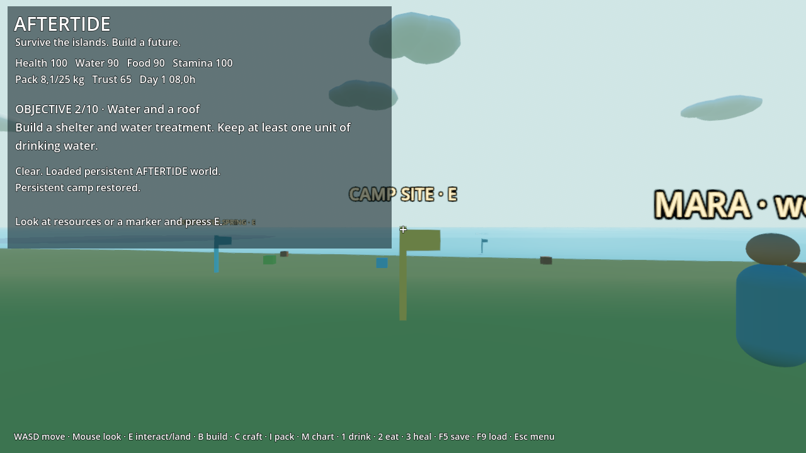

# AFTERTIDE

**Survive the islands. Build a future.**

An independent first-person Caribbean survival, exploration and settlement game.
Carry supplies home, treat water, process food, assign a survivor, build a coastal
boat and prepare a persistent community for a forecast storm.

## Development status

Experimental source prototype, not a finished release. The first chapter has ten
data-defined objectives. Automated simulation tests cover their condition chain,
production, finite exchange, spoilage and save/receipt restoration. Those tests
are **not** a complete manual 3D playthrough. Visuals are original procedural
placeholders; more art, interaction, navigation and release testing are needed.



This image documents an actual runtime smoke test, not final art acceptance.

The overview includes actual generalized coastlines across the Caribbean;
only one roughly 1 km square starting area near northeastern Jamaica is loaded
as detailed 3D. Local units are metres. Relief is authored procedural terrain,
not a surveyed DEM. The entire Caribbean is not implemented as playable terrain.

## Run from source

1. Install **Godot 4.7.2 .NET** and a **.NET 10 SDK**. Standard Godot without
   .NET cannot run this C# project.
2. Run `dotnet build Aftertide.csproj` in the repository root.
3. Import `project.godot` in Godot .NET, wait for import, then press F6 on
   `Aftertide/Main.tscn` or F5 to run the project.

The implementation is also tested locally with the NVIDIA Godot fork pinned at
`49a825dc52c0f1892ff5ce5cdbbe7572c638d41a`. To compile against a custom matching
SDK, pass `-p:AftertideGodotSdkPath=<extracted Godot.NET.Sdk directory>` and your
matching local NuGet source. Do not mix managed APIs and engine binaries.
Path tracing, DLSS/frame generation and PhysX 5 are **not verified game features**.

No AI service, API key, account or internet connection is required at runtime.

## Controls and first camp

| Key | Action |
| --- | --- |
| WASD / mouse | Move / look |
| Shift / Space | Sprint / jump |
| E | Interact, collect, board or land; confirm construction |
| B / C / I / M | Build / craft / backpack / geographic chart |
| 1 / 2 / 3 | Drink / eat / use dressings |
| F5 / F9 | Save / load |
| Esc | Menu or cancel placement |

Start at the camp marker and press E. Gather timber, stones and fibre, and build
the shelter and water treatment. Untreated spring water must be processed.
Deposit inputs at camp; craft with materials in your backpack. Food ages during
storage and transport. Assign Mara to a supported work site and supply its inputs.
Boats require shallow water near the marked boat site. Land at the supply cove,
recover cargo, return and deposit it. Build reserves before starting the storm
forecast. The world persists after the chapter and after setbacks.

Saves are separate from any older project: editor runs use
`outputs/aftertide-saves/world-1.json`; portable packaged builds use `saves/`
beside the executable. Keep the previous-save backup when reporting load issues.

## Automated checks

```sh
dotnet run --project tests/Aftertide.Checks.csproj -- Aftertide/Data
```

For an engine smoke test, set `AFTERTIDE_SMOKE=1`, choose an isolated save directory
under `outputs/aftertide-playtests/<run-id>` using `AFTERTIDE_SAVE_DIR`, then run
Godot .NET with `--headless --path .`. Require `AFTERTIDE_SMOKE_PASS` and exit 0.
This additionally checks local terrain collision, content creation and actual
save I/O. Headless checks do not establish graphics quality or achieved FPS.

## Contribute

Read [CONTRIBUTING](CONTRIBUTING.md), [architecture](docs/ARCHITECTURE.md),
[roadmap](docs/ROADMAP.md) and [Code of Conduct](CODE_OF_CONDUCT.md).
Report reproducible problems through GitHub Issues. Good contributions include
focused regression tests, input/accessibility improvements and cleared original art.

## License, provenance and working name

Original code and original procedural assets: Apache-2.0. Natural Earth coast data:
public domain. Godot and .NET retain their own licenses. See [NOTICE](NOTICE.md)
and [source map](docs/SOURCES.md). No commercial-game assets are included.

AFTERTIDE is a working name. A name search found the unrelated existing game
*Aftertide: Lost Depth Survival*. This project is not affiliated with it; no
trademark clearance is asserted. Naming review remains open before a release.
